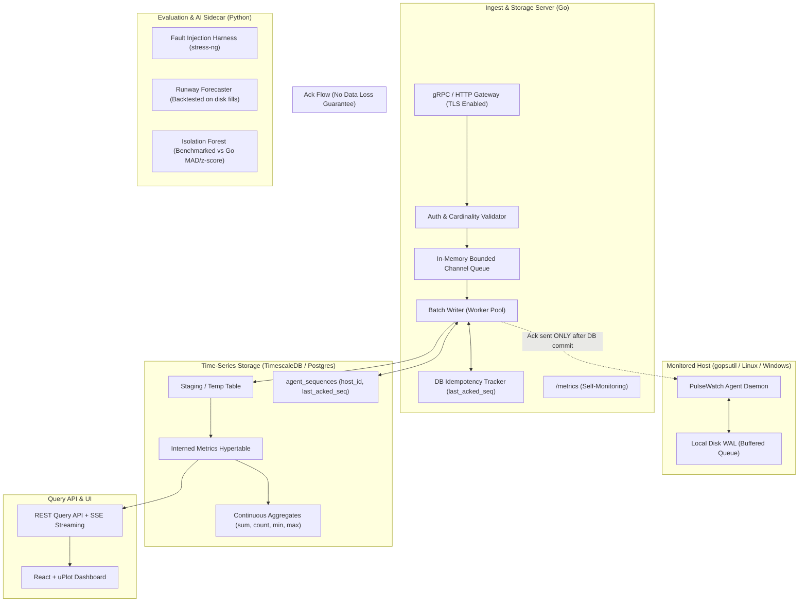

# PulseWatch: Master Implementation Plan (Revised)
## Real-Time Distributed System Monitoring Platform

> [!IMPORTANT]
> **Core Architectural Principles**:
> 1. **True Reliability**: Acks are delivered only after database transactions commit. Zero data loss is verified across server outages and restarts via automated chaos tests.
> 2. **Durable Idempotency**: Dedup survives server crashes by tracking committed sequence numbers and unique keys directly in the database.
> 3. **Controlled Cardinality**: Interned metric and label IDs; strictly top-N processes labeled by executable name (never PID).
> 4. **Thin Vertical Slices**: Walk one metric end-to-end first before widening collectors or adding sidecars.
> 5. **Evidence-Based Evaluation**: Detector accuracy (precision, recall, MTTD) and runway forecasts are measured against ground-truth fault injection.

---

## 1. System Architecture & Corrected Semantics



---

## 2. Technical Decisions & Fixes Applied

### A. Delivery Guarantees & Zero Data Loss
* **The Problem**: Acknowledging upon pushing to an in-memory queue risks silent data loss if the server crashes before writing to the database.
* **The Fix**: **Deferred Acks**. The ingest server accepts batches into a bounded channel. Worker goroutines assemble bulk insert batches. Once the database transaction commits, a response channel signals the gRPC/HTTP handler to send the client `Ack(seq)`. If the server crashes before commit, the agent never receives an ack and replays its local WAL upon reconnect.
* **Verified Scope**: Zero data loss across server outages, restarts, and network partitions.

### B. Durable Deduplication Across Restarts
* **The Problem**: In-memory sequence caches wipe on server restart—the exact moment the agent replays its WAL.
* **The Fix**: 
  1. An `agent_sequences` table in PostgreSQL stores `(host_id, last_acked_seq, updated_at)`.
  2. For atomic bulk ingestion, data is written via `COPY` into an unlogged temporary staging table, followed by `INSERT INTO metrics ... SELECT ... ON CONFLICT DO NOTHING`.
  3. The `last_acked_seq` is updated in the same transaction. Any batch with `seq <= last_acked_seq` is recognized as an already-persisted duplicate and acknowledged without re-inserting.

### C. Scalable Interned Schema & Cardinality Guard
* **The Problem**: Storing raw strings for `metric_name` and JSON labels on every row wastes disk and causes index bloat. Tracking per-PID processes causes infinite cardinality.
* **The Fix**:
  * `metric_definitions(id SERIAL PRIMARY KEY, name VARCHAR(128) UNIQUE)`
  * `label_sets(id BIGSERIAL PRIMARY KEY, hash BIGINT UNIQUE, labels JSONB)`
  * Hot hypertable: `metrics(ts TIMESTAMPTZ NOT NULL, host_id BIGINT NOT NULL, metric_id INT NOT NULL, label_set_id BIGINT NOT NULL, value DOUBLE PRECISION NOT NULL)`
  * Partitioned by `ts` (7-day raw retention).
  * **Process Collector Policy**: Track only top 10 processes by CPU/memory; label strictly by executable name (`comm`), **never PID**.
  * **Cardinality Limit**: Reject or quarantine payloads containing un-whitelisted label keys or values exceeding max cardinality limits ($>1{,}000$ active series per host).

### D. Mathematically Correct Rollups
* **The Problem**: Averages of averages distort statistical truth, and continuous aggregates do not support arbitrary `percentile_cont` without the TimescaleDB Toolkit.
* **The Fix**:
  * 1-minute, 5-minute, and 1-hour continuous aggregates store: `metric_id`, `host_id`, `bucket`, `sum_val`, `count_val`, `min_val`, `max_val`.
  * Rollup queries compute true mathematical average as `SUM(sum_val) / SUM(count_val)`.
  * Percentiles ($p95$) are either computed via TimescaleDB Toolkit's `percentile_agg` (t-digest) or scheduled rollups over 1-minute buckets.

### E. Operating System & Portability
* The agent uses `gopsutil` for cross-platform metric extraction (runs natively on Windows during development and on Linux in production/containers), with clean interface abstractions allowing direct `/proc` extraction when running on Linux.

### F. Self-Monitoring (`/metrics`)
* Both Agent and Ingest Server expose standard `/metrics` endpoints tracking:
  * `pulsewatch_agent_wal_queue_bytes`
  * `pulsewatch_agent_wal_replayed_points_total`
  * `pulsewatch_server_ingest_points_received_total`
  * `pulsewatch_server_buffer_queue_depth`
  * `pulsewatch_server_batch_commit_latency_seconds`
  * `pulsewatch_server_dropped_points_total`

---

## 3. Thin Vertical Slice Implementation Roadmap

```
Phase 1: Foundation (Repo, Compose with Timescale, CI, Proto)
   │
   ▼
Phase 2: Walking Skeleton (One metric: Agent CPU -> Server -> DB -> curl)
   │
   ▼
Phase 3: Reliability Core (WAL, Retries/Backoff, DB Idempotency, Deferred Acks, TLS, Chaos Test)
   │
   ▼
Phase 4: Widen (Remaining Collectors, Top-N Proc, Heartbeats, Interned Schema, Rollups, /metrics)
   │
   ▼
Phase 5: API & Dashboard (REST API, SSE Live Stream, React + uPlot)
   │
   ▼
Phase 6: Alerting (Rule Evaluator, State Machine with Hysteresis, Notifiers, Go Streaming Detectors)
   │
   ▼
Phase 7: Loadgen & Rigorous Evaluation (Loadgen, Ingest Benchmarks, Fault Injection Ground Truth)
   │
   ▼
Phase 8: Python ML Sidecar (Capacity Runway Forecaster + Isolation Forest Benchmark)
```

---

### Phase 1: Foundation (Day 1)
* **Step 1.1**: Initialize Go workspace (`go mod init pulsewatch`), directory layout, and `.gitignore`.
* **Step 1.2**: `deploy/docker-compose.yml` spinning up PostgreSQL 16 with TimescaleDB.
* **Step 1.3**: GitHub Actions CI workflow (`.github/workflows/ci.yml`) running `golangci-lint` and `go test -race`.
* **Step 1.4**: `proto/metrics.proto`: Protobuf data contracts:
  * `MetricPoint { metric_id, label_set_id, timestamp, value }`
  * `MetricBatch { host_id, seq, points[] }`
  * `BatchAck { host_id, seq, status }`
  * `Heartbeat { host_id, timestamp, agent_version, labels }`
* **Test**: Compile protobufs into Go; spin up TimescaleDB container; verify CI passes on commit 1.

---

### Phase 2: Walking Skeleton (One Metric End-to-End)
* **Step 2.1**: Agent collects **CPU utilization only** (via `gopsutil/cpu`).
* **Step 2.2**: Ingest Server accepts `MetricBatch` over gRPC (plain credentials for skeleton test).
* **Step 2.3**: Database migration initializing `metrics` hypertable. Server inserts batch into TimescaleDB.
* **Step 2.4**: Minimal health/query HTTP endpoint (`GET /api/v1/metrics/latest?host=...&metric=cpu_total`).
* **Test**: Run agent $\rightarrow$ Server writes to Timescale $\rightarrow$ Query with `curl` and see live CPU numbers.

---

### Phase 3: The Reliability Core (Primary Interview Anchor)
* **Step 3.1**: **Agent Local Disk WAL**:
  * Append-only binary log with segmented rolling files and bounded total disk size.
  * Spools metrics when disconnected; replays in sequence upon reconnection.
* **Step 3.2**: **Network Transport & Security**:
  * TLS configured for agent-to-server gRPC communication.
  * Exponential backoff with full jitter on agent sender.
* **Step 3.3**: **Deferred Acks**:
  * Ingest server buffers incoming batches into a bounded worker pool.
  * Ingest server acks the agent **only after** the DB transaction commits.
* **Step 3.4**: **Database-Level Idempotency**:
  * `agent_sequences` table updates atomic with batch commits.
  * Replayed duplicate batches are recognized and safely acknowledged without double insertion.
* **Step 3.5**: **Server-Outage Chaos Test**:
  * Automated test: Start Agent $\rightarrow$ kill Server for 3 minutes $\rightarrow$ verify Agent buffers to disk $\rightarrow$ restart Server $\rightarrow$ verify replay with **zero data points lost** and **zero duplicate rows**.
* **Test**: `go test -race ./agent/... ./server/...` and run `bench/chaos_server_outage.sh`.

---

### Phase 4: Widen Platform Capabilities
* **Step 4.1**: Remaining collectors: Memory, Swap, Disk I/O, Network, and **Top-N Process Collector** (strictly filtered to top 10 by CPU/RSS, labeled by executable name, never PID).
* **Step 4.2**: Host Registration & Heartbeats:
  * Persistent machine UUID (`/etc/machine-id` or OS hardware ID).
  * Host table: `hosts(id, hostname, os, arch, ip, first_seen, last_heartbeat, status)`.
  * Background reaper marking hosts `offline` after missed heartbeats.
* **Step 4.3**: Interned relational schema:
  * `metric_definitions` and `label_sets` lookup tables with in-memory LRU cache on the server.
  * Cardinality limit guard rejecting high-entropy tags.
* **Step 4.4**: Continuous aggregates for 1-minute, 5-minute, and 1-hour rollups (`sum`, `count`, `min`, `max`).
* **Step 4.5**: Expose `/metrics` on both Agent and Server for self-observability.
* **Test**: Unit tests parsing mock system metrics; verify interned ID caching and rollup query math.

---

### Phase 5: Query API & Live Dashboard
* **Step 5.1**: Server REST API:
  * `GET /api/v1/hosts` (list with online/offline state and last heartbeat).
  * `GET /api/v1/metrics/query` (with automatic rollup resolution based on time range).
* **Step 5.2**: Server-Sent Events (SSE) endpoint:
  * `/api/v1/stream/metrics?host=...` for low-overhead, one-way real-time chart updates.
* **Step 5.3**: React + TypeScript + Vite Dashboard:
  * Host inventory table with live status badges.
  * Host detail page with fast `uPlot` charts (CPU, memory, disk I/O, network).
  * Top process view.
* **Test**: End-to-end browser verification of live data streaming.

---

### Phase 6: Streaming Detection & Alerting
* **Step 6.1**: Real-time statistical detectors in Go:
  * Rolling z-score, EWMA (Exponential Weighted Moving Average), and MAD (Median Absolute Deviation).
* **Step 6.2**: Alert Rule Evaluator:
  * Evaluates conditions like `metric > threshold for duration N`.
* **Step 6.3**: Alert State Machine:
  * Lifecycle: `Pending` $\rightarrow$ `Firing` $\rightarrow$ `Resolved`.
  * Flap protection (hysteresis thresholds) to prevent alert storming.
* **Step 6.4**: Webhook Notifier (Slack / Discord / generic JSON webhook with retries).
* **Test**: Unit test state machine transitions; inject synthetic metric spikes and verify firing and resolution alerts.

---

### Phase 7: Load Generator, Benchmarks & Evaluation
* **Step 7.1**: `loadgen/main.go`:
  * Simulates 100 to 1,000 agents emitting realistic metrics.
* **Step 7.2**: Performance Benchmarking:
  * Measure sustained ingestion throughput (points/sec) and p50/p95/p99 latency.
  * Measure agent resource overhead (< 1% CPU, < 30 MB RAM).
* **Step 7.3**: Ground-Truth Detection Evaluation:
  * Use `stress-ng` (or synthetic fault injector) to generate known anomalies: CPU spikes, gradual memory leaks, disk fills, network packet loss.
  * Compute and report exact **Precision**, **Recall**, and **Time-to-Detect (TTD)** for each Go detector.
* **Test**: Run complete automated evaluation suite and output benchmark report.

---

### Phase 8: Focused AI / ML Sidecar (Evaluation & Runway)
* **Step 8.1**: Python service setup (`fastapi`, `scikit-learn`, `numpy`, `pandas`).
* **Step 8.2**: **Resource Runway Predictor**:
  * Polynomial/linear trend model predicting hours until disk or memory exhaustion.
  * **Ground-Truth Backtesting**: Evaluated against synthetic disk-fill curves with known exhaustion timestamps to measure error margin ($\pm\text{ hours}$).
* **Step 8.3**: **Isolation Forest Anomaly Detector**:
  * Multi-metric anomaly detection benchmarked directly against the Go detectors on the Phase 7 fault dataset.
  * Document honest trade-offs: precision/recall delta vs inference latency and resource overhead.
* **Step 8.4**: Surface runway forecasts and model comparison metrics on the dashboard.
* **Test**: Run backtest suite and verify forecast accuracy.

---

## 4. Execution Policy

* Every step is executed **one file and one process at a time**.
* Every step includes its own unit/integration tests before progressing.
* Every architectural decision is reviewed together.
